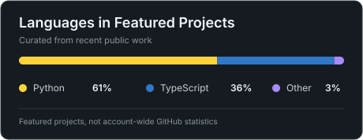

<h1 align="center">Hi there, I'm Jeremy 👋</h1>

Backend Developer • AI-powered workflows • Brazilian Jiu-Jitsu

  <a href="mailto:jeremyjdsoftware@gmail.com">jeremyjdsoftware@gmail.com</a> •
  <a href="https://linkedin.com/in/jeremydelgadosoft">LinkedIn</a>

  

---

## Core Stack

| Area | Technologies |
| --- | --- |
| **Languages** | Python, TypeScript |
| **Backend** | FastAPI, Django, Django REST Framework, NestJS |
| **Agentic AI** | LLM Agents, Multi-Agent Systems, LangGraph, Agno, MCP, RAG, Function Calling |
| **LLM Providers** | OpenAI, Anthropic, Gemini, Groq/Llama |
| **Architecture** | Clean/Hexagonal, Repository Pattern, Service Layer, CQRS |
| **Data & Messaging** | PostgreSQL, MongoDB, Redis, RabbitMQ |
| **Infrastructure** | Docker, Azure, Supabase, Render, Google Cloud Run |
| **Testing & Quality** | pytest, unit/integration testing, Ruff, SonarQube |

  

  

---

🥋 I train Brazilian Jiu-Jitsu — discipline, fundamentals, and consistency.
